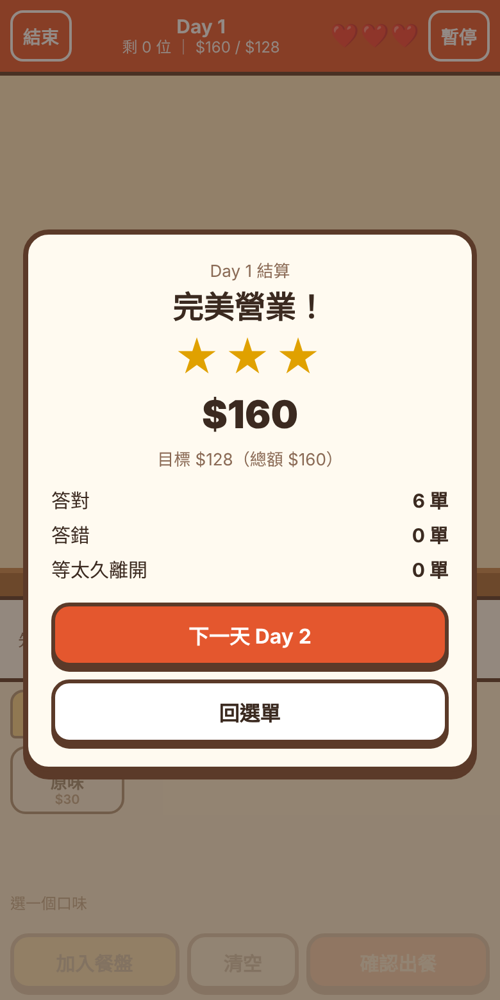

# 帥哥、美女今天要吃什麼？

> 早餐店老闆的記憶力大考驗：用 Vibe Coding 做出的手機網頁小遊戲

**🎮 立即遊玩：<https://你的帳號.github.io/你的repo名稱/>**

<!-- 上傳後請把上面的網址換成你的 GitHub Pages 網址 -->

玩家扮演早餐店老闆，憑記憶幫最多 5 位同時排隊的客人出餐。共 30 天，每天解鎖新菜色、難度逐步提高，第 31 天起進入無限模式。

## 介面截圖

<table>
  <tr>
    <td align="center"> 標題畫面</td>
    <td align="center"> 客人點單</td>
    <td align="center"> 組餐出餐</td>
    <td align="center"> 結算畫面</td>
  </tr>
</table>

## 怎麼玩

1. 客人頭上的點單泡泡只顯示幾秒，之後縮成「…」，要靠記憶。
2. 先點一位客人，再從下方選分類、口味、選項，加入餐盤後按「確認出餐」。
3. 答錯扣 1 顆心；忘記了可以花 1 顆心「重看」點單。
4. 客人等太久會離開，這單就沒錢賺。
5. 當天營收達到總額的 80% 就過關，解鎖下一天。

## 規格重點

- **手機直式為主**，電腦開啟時以手機大小的畫面置中顯示。
- **菜單**：蛋餅、吐司、漢堡、鐵板麵、小點、飲料，共 30 種品項，選項有加蛋、大／中杯、冰／溫／去冰。
- **難度**：記憶時間從 6 秒縮短到 3 秒，客人從 6 位增加到 20 位，每單最多從 1 樣增加到 5 樣。
- **技術**：單一 `index.html`，不用任何圖片檔或外部函式庫，所有人物和食物都用 CSS 畫；進度存在瀏覽器（localStorage）。

## AI 迭代紀錄

| 版本 | 修改內容 |
| --- | --- |
| v0.1～v0.6 | 和 AI 討論規格：選定題目、改成 5 位客人同時排隊、加入記憶時間、停留時間改用公式、移除小費與 Combo、加上結束鍵 |
| v1.0 | 第一版實作；實測後修正泡泡位置、新品出題機率、矮螢幕版面 |
| 後續測試 | 試過兩種電腦版顯示方式（縮小插圖並允許捲動、整個畫面等比例縮放），比較後決定保留手機體驗最好的 v1.0 |
