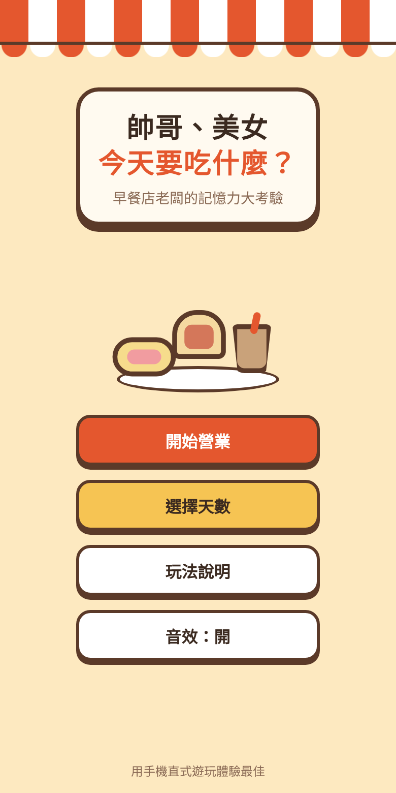
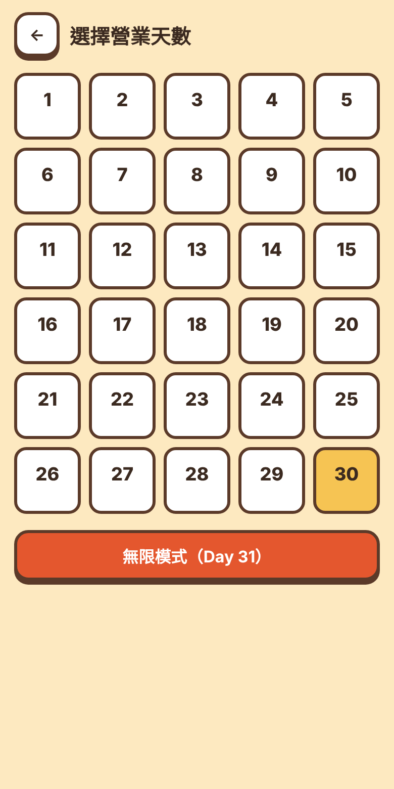
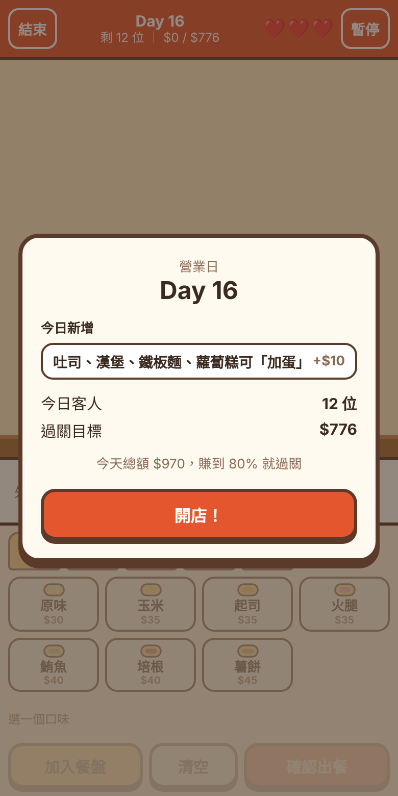
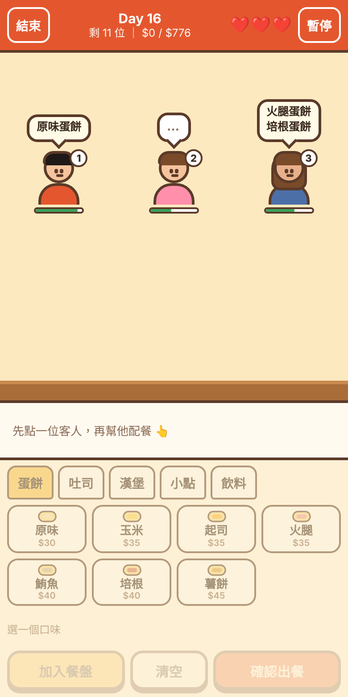
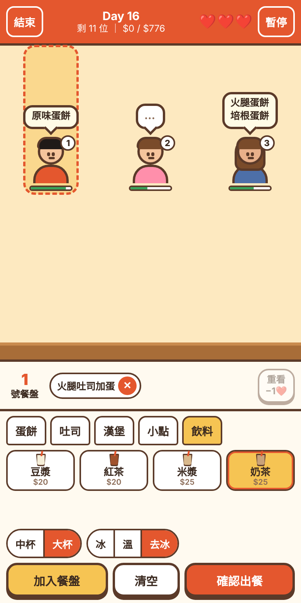

# 帥哥、美女今天要吃什麼？

> 早餐店老闆的記憶力大考驗：用 Vibe Coding 做出的手機網頁小遊戲

**🎮 立即遊玩：<https://你的帳號.github.io/你的repo名稱/>**

<!-- 上傳後請把上面的網址換成你的 GitHub Pages 網址 -->

玩家扮演早餐店老闆。客人進門時只說一次點單，泡泡幾秒後就縮起來，老闆要憑記憶幫最多 5 位同時排隊的客人組出正確的餐點。遊戲共 30 天，每天解鎖新菜色、難度逐步提高，第 31 天起進入無限模式。

## 介面截圖

<table>
  <tr>
    <td align="center"> 標題畫面</td>
    <td align="center"> 選擇天數</td>
    <td align="center"> 開場卡（今日新增）</td>
  </tr>
  <tr>
    <td align="center"> 客人點單（2 號泡泡已縮起）</td>
    <td align="center"> 選客人、組餐、選飲料選項</td>
    <td align="center"> 結算畫面</td>
  </tr>
</table>

## 怎麼玩

1. 客人進來時，頭上泡泡會顯示點單幾秒，之後縮成「…」，**要靠記憶**。
2. 先點一位客人，再從下方依序選「分類 → 口味 → 選項」，按「加入餐盤」。
3. 餐點都組好後按「確認出餐」，內容完全正確才算答對。
4. 答錯扣 1 顆心。忘記了可以按「重看」，同樣扣 1 顆心，剩 1 顆心時不能重看。
5. 客人等太久會自己離開，這單就沒有收入。
6. 當天營收達到總額的 80% 就過關，並解鎖下一天和新菜色。

## 規格說明

### 核心規則

| 項目 | 規則 |
| --- | --- |
| 客人 | 同時最多 5 位（上排 3 位、下排 2 位），有人離開才補上；每天的客人數固定 |
| 記憶時間 | 點單泡泡只顯示幾秒：Day 1 是 6 秒，逐日縮短到 Day 30 的 3 秒 |
| 停留時間 | 停留秒數 = (8 + 4 × 品項數) × 節奏係數；係數從 1.0 逐步降到 0.8 |
| 愛心 | 每天 3 顆；答錯扣 1 顆、重看扣 1 顆，等太久離開不扣；歸零就當天失敗 |
| 營收 | 只計答對的餐點金額（早餐店不收小費） |
| 過關 | 營收 ≥ 當天總額的 80%；未達標就重玩同一天 |
| 星等 | 80% 一顆星、90% 兩顆星、100%（全部答對）三顆星 |
| 結束與暫停 | 狀態列有「結束」（確認後回上一頁、不計成績）與「暫停」；切換到其他 App 會自動暫停 |

### 菜單

| 分類 | 品項（價格） | 選項 |
| --- | --- | --- |
| 蛋餅 | 原味 $30、玉米 $35、起司 $35、火腿 $35、鮪魚 $40、培根 $40、薯餅 $45 | 無 |
| 吐司 | 火腿 $30、培根 $35、鮪魚 $35、肉鬆 $30、花生 $25、草莓 $25 | 加蛋 +$10 |
| 漢堡 | 豬肉 $40、雞腿 $55、牛肉 $50、鮪魚 $45、卡拉雞腿 $60 | 加蛋 +$10 |
| 鐵板麵 | 蘑菇 $55、黑胡椒 $55、茄汁 $55 | 加蛋 +$10 |
| 小點 | 煎餃 $40、蘿蔔糕 $35、雞塊 $40、薯條 $35、薯餅 $30 | 蘿蔔糕可加蛋 |
| 飲料 | 豆漿、紅茶 $20；米漿、奶茶 $25 | 大杯 +$5、冰／溫／去冰 |

### 30 天難度安排

| 天數 | 新增內容 | 難度變化 |
| --- | --- | --- |
| Day 1～5 | 原味蛋餅、紅茶、火腿吐司、豆漿、蘿蔔糕、奶茶、米漿、煎餃 | 客人 6～8 位，每單最多 2 樣 |
| Day 6～12 | 蛋餅與吐司的各種口味；Day 9 開放大／中杯，Day 12 開放冰／溫／去冰 | 每單最多 3 樣，記憶時間縮短到 5 秒 |
| Day 13～22 | 漢堡、Day 16 開放加蛋、雞塊、薯條、薯餅、鐵板麵（Day 22 全菜單到齊） | 每單最多 5 樣，客人耐心變短 |
| Day 23～30 | 不再加新品 | 客人更多、來得更快、記憶時間更短；Day 30 是 20 位客人的「期末大魔王日」 |
| Day 31～ | 無限模式 | 全菜單隨機出題，客人每天多 1 位 |

每天新解鎖的品項和選項至少會出現 2 次，讓玩家有機會練習。

### 技術

- 單一 `index.html`，HTML、CSS、JavaScript 寫在同一個檔案，不用任何圖片檔或外部函式庫。
- 客人、食物圖示、招牌都是用 CSS 畫的插畫風。
- 手機直式為主；電腦開啟時以手機大小的畫面置中顯示。
- 音效用 Web Audio API 即時產生，可以關閉；Android 手機答錯時會震動。
- 進度存在瀏覽器的 localStorage，關掉網頁再開，已解鎖的天數和星等都還在。
- 網址加上 `?dev=1` 可以解鎖全部天數，方便測試。

## AI 迭代紀錄

這個作品從想法、規格到實作，都是和 AI（Claude）反覆討論、修改完成的。

| 版本 | 發現的問題／想法 | 修改 |
| --- | --- | --- |
| v0.1 | 料理模擬類的小遊戲大多已經有人做過 | 改從「台灣日常小場景」找題目，選定早餐店記憶挑戰，以手機版為主 |
| v0.2 | AI 的初版一次只有一位客人 | 改成最多 5 位同時排隊、老闆自己決定先出誰的餐；加入 3 顆心、30 天＋無限模式 |
| v0.3 | 點單如果一直顯示，就不是記憶挑戰了 | 泡泡只顯示幾秒就縮起，而且越後面的天數越短 |
| v0.4 | 客人只待 12 秒，點 5 樣餐會來不及；重看扣 2 顆心，跟只有 3 顆心衝突 | 停留時間改用公式；重看改扣 1 顆心；等太久不扣心 |
| v0.5 | 「火腿蛋吐司加蛋」語意重複 | 改成火腿、培根吐司；蛋餅不能加蛋 |
| v0.6 | 早餐店不會有小費；遊戲中沒有離開的方法 | 移除小費與 Combo；狀態列加上「結束」鍵 |
| v1.0 | 第一版實測：泡泡離客人太遠、有幾天新品偶爾只出現 1 次、矮螢幕泡泡被擋住 | 泡泡改貼在客人頭上、修正出題邏輯、矮螢幕壓縮版面 |
| 後續測試 | 試過兩種電腦版顯示方式（縮小插圖並允許捲動、整個畫面等比例縮放） | 比較後決定保留手機體驗最好的 v1.0 |
